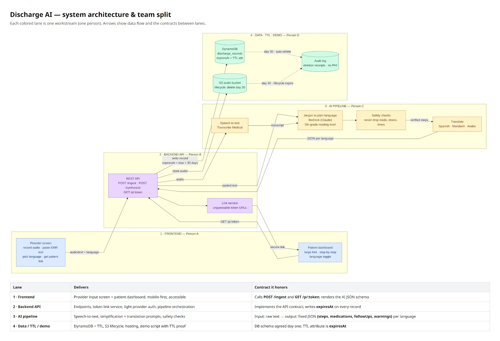

# DischargeAI

Discharge instructions go in as dictated audio, pasted EMR text or a PDF. A plain-language, step-by-step version comes out at a secure link, in the patient's own language, and every byte of it self-destructs exactly 30 days after it was created.

Built at Rutgers Health Hack 2026 for the Ops Unleashed track, Challenge 1 "Discharge AI".

> Backend on this branch: `backend/README.md` is the full guide for the API, the team infrastructure (Secrets Manager, RDS MariaDB, DynamoDB `discharge-summaries`, S3 `emraudio-rh`), the demo narrative and what was verified live. Start it with `cd backend && npm install && npm run dev`, then `npm run demo`.



## The problem

Discharge paperwork is dense, full of clinical jargon, and usually printed in English only. Patients leave the hospital unsure which medications changed, when to come back, and what counts as an emergency, and that confusion feeds 30-day readmissions. At the same time, institutional policy requires that the patient's data permanently disappear 30 days after discharge.

DischargeAI closes both gaps with three automated workflows:

1. **Ingest.** A nurse records a dictation, pastes the EMR text, or drops the discharge PDF on one screen.
2. **Synthesize and translate.** The AI pipeline rewrites the instructions at a fifth-grade reading level, keeps every drug name, dose and time exactly as written, and translates into the patient's language in one tap.
3. **Host for 30 days, then destroy.** The patient opens an unguessable link on their phone. The link, the record and the audio all expire and are purged 30 days after creation, enforced in code and in the database.

Judges score the clinical-to-vernacular translation, the technical architecture and compliance (audio and text in, a working 30-day self-destruct), the patient-facing user experience, and a live demo that proves the expiry rule is real.

## Architecture

The diagram above is the contract between four lanes. Arrows are data flow; the table is what each lane delivers and what it promises the others.

| Lane | Delivers | Contract it honors |
| --- | --- | --- |
| 1 · Frontend | Provider input screen and patient dashboard, mobile-first, large type, accessible | Calls `POST /ingest` and `GET /p/:token`; renders the per-language AI JSON |
| 2 · Backend API | Endpoints, token link service, provider auth, pipeline orchestration | Implements the API below; writes `expiresAt` on every record |
| 3 · AI pipeline | Speech-to-text, simplification and translation prompts, safety checks | Raw text in, one fixed JSON object (`steps`, `medications`, `followUps`, `warnings`) per language out |
| 4 · Data, TTL, demo | DynamoDB with TTL, S3 lifecycle, hosting, demo script with proof of expiry | Schema agreed on day one; the TTL attribute is `expiresAt` |

### Pipeline (lane 3)

```
audio ──(1) transcribe──> transcript ──(2) simplify──> draft ──(3) safety check──> verified steps
                                                                       └──(4) translate, per language──> JSON per language
```

- **Transcribe**: Amazon Transcribe Medical (dictation, primary care), or an offline fixture transcript.
- **Simplify**: a Claude model on Amazon Bedrock through the Converse API with tool-based JSON output, so the model can only answer in the contract's schema. The direct Anthropic API and a keyless offline provider (curated fixtures for the five sample summaries, rule-based extraction for anything else) are drop-in alternatives.
- **Safety check**: deterministic, after the model. Every medication name and every numeric dose in the draft must appear verbatim in the clinician's text (units normalized, ratio doses such as 875/125 mg handled). A miss fails the check, flags the job `needs_review`, and adds a clinic-tier warning the patient sees. Reading grade is measured with Flesch-Kincaid and reported.
- **Translate**: field by field, with medication names, doses and frequencies passed through untouched. The translation is back-translated to English and diffed on numbers and drug names; mismatches become warnings.

Each stage is an interface. Swap the model with `LLM_PROVIDER`, or replace a stage outright in `backend/src/agents/pipeline.ts`.

### Storage and the 30-day clock (lanes 2 and 4)

- **SQL** (SQLite by default; the team's RDS MariaDB instance through `mysql2` with TLS when its host is known, see `backend/README.md`) holds patients, links, jobs, the audit log and checklist state. The link table stores only the SHA-256 of the link id and a per-link AES-256-GCM data key. A database dump reveals no usable links.
- **Document store** (DynamoDB table `discharge-summaries`, hash key `uid`, TTL attribute `expiresAt`; or a SQLite twin with the same shape) holds the encrypted clinician text, the simplified JSON and each translation. Every item carries `expiresAt` in epoch seconds so DynamoDB's own TTL deletes it.
- **Audio** is sealed with the same per-link key, in a local directory or an S3 bucket with server-side encryption and a 30-day lifecycle rule.
- **Expiry** is `createdAt + 30 days`, computed in code from an injectable clock. Every patient read compares it to the clock before touching the store and answers `410` once it has passed, independent of any background job.
- **Purge** runs on an interval and on demand. It destroys the per-link key first (crypto-shredding, so lagging deletes are already unreadable), deletes the document items and the audio object, marks the link purged, clears the patient's active link, and writes a deletion receipt for every key, record and object into the audit log. The audit log never contains PHI.
- **Demo mode** exposes `POST /admin/clock/advance { "days": 30 }` so a judge can watch day 30 arrive, the link turn `410`, and the purge receipts appear.

## Repository layout

```
backend/    Node 22 + TypeScript + Express 5 API, pipeline, stores, purge job, tests, OpenAPI
frontend/   Vite + React 19 + Tailwind 4 provider portal
scripts/    host setup script (git, Python 3, Node 24, MariaDB)
certs/      AWS RDS certificate bundle
docs/       the architecture diagram
```

Work is on lane branches until it merges into `main`:

| Branch | Holds |
| --- | --- |
| `alt-backend` | The current backend: everything on `backend` plus the lane-3 pipeline module, `GET /p/:token`, `POST /synthesize`, the audio store and the team DynamoDB table |
| `backend` | The earlier backend state the above builds on |
| `frontend` | The provider portal (`1-implement-speech-processing` points at the same commit) |
| `feature/infra-setup` | The host setup script and the RDS certificate bundle |

## Run it locally

Backend, no keys needed (offline providers, SQLite, email printed to the console, demo mode on):

```sh
cd backend
npm install
cp .env.example .env
npm run dev          # http://localhost:4000, Swagger UI at /docs
```

In a second terminal, the demo narrative end to end:

```sh
cd backend
npm run demo
```

It ingests the sample CHF discharge summary, polls the job, shows the printed patient email, reads the summary, translates it to Spanish (the second call comes from cache), ticks a checklist item, advances the clock 30 days to get a `410`, runs the purge, prints the PHI-free audit trail, and resets the clock.

Frontend:

```sh
cd frontend
npm install
npm run dev          # http://localhost:5173
```

Checks:

```sh
cd backend
npm test             # vitest, offline providers
npm run typecheck    # tsc --noEmit
```

On the `alt-backend` branch, 88 tests across 19 files pass and the typecheck is clean (run 10 Oct 2026 with the offline providers).

### Live providers

Set these in `backend/.env` to leave offline mode. AWS credentials come from the standard chain (shell variables, a profile, or an instance role) and are never written to the repo.

| Setting | Offline default | Live value |
| --- | --- | --- |
| `LLM_PROVIDER` | `offline` | `bedrock` (model from `BEDROCK_MODEL_ID`, region from `AWS_REGION`) or `anthropic` (needs `ANTHROPIC_API_KEY`) |
| `TRANSCRIBE_PROVIDER` | `offline` | `aws`, with `TRANSCRIBE_BUCKET` and `TRANSCRIBE_OUTPUT_BUCKET` |
| `DOC_STORE` | `local` | `dynamo`, with `DYNAMO_TABLE` and `DYNAMO_PK`; set `DYNAMO_ENDPOINT` for DynamoDB Local (`docker compose up -d`, then `npm run setup-dynamo`) |
| `AUDIO_STORE` | `local` | `s3`, with `AUDIO_BUCKET`; run `npm run put-s3-lifecycle` once to install the 30-day rule |
| `EMAIL_TRANSPORT` | `console` | `ses` or `smtp` (`SMTP_URL`); `EMAIL_QUEUE=sqs` hands off to `scripts/email-worker.ts`, which also exports a Lambda handler |
| `DEMO_MODE` | `true` | `false` in anything resembling production; it unmounts the `/admin` routes |

`backend/.env.example` lists every variable with a comment. The provider endpoints require the `x-provider-key` header, whose value is `PROVIDER_API_KEY`.

AWS permissions the live path uses: Bedrock `InvokeModel`; DynamoDB `CreateTable`, `UpdateTimeToLive`, `DescribeTimeToLive`, `PutItem`, `GetItem`, `Query`, `DeleteItem`; S3 `PutObject`, `GetObject`, `DeleteObject`, `GetLifecycleConfiguration`, `PutLifecycleConfiguration`; Transcribe `StartMedicalTranscriptionJob`, `GetMedicalTranscriptionJob`; SES `SendEmail`; SQS `SendMessage`, `ReceiveMessage`, `DeleteMessage`.

## API

Provider endpoints need the `x-provider-key` header. Patient endpoints are authenticated only by the 22-character link id, carry no header, and are rate-limited. Swagger UI at `/docs` documents every route, including `GET /p/:token`, `POST /synthesize` and `/contracts`; `backend/README.md` has the curl examples.

**Provider**

| Method and path | What it does |
| --- | --- |
| `GET /patients?q=` | List or search the seeded synthetic patients (name, email, phone substring) |
| `POST /patients` | Create a patient |
| `GET /patients/:id` | One patient, with `activeLinkId` and `activeLinkExpiresAt` |
| `POST /ingest` | Multipart: `patientId` plus exactly one of `text`, `file` (PDF) or `audio` (wav, mp3, m4a, webm, ogg, flac); optional `language`, `caregiverEmail`, `caregiverApproved`. Returns `202 { jobId, linkId, link, expiresAt, statusUrl }` before any model call runs |
| `POST /synthesize` | `{ text, languages? }` runs the pipeline as a dry run and returns the JSON per language; `{ linkId, languages?, text? }` re-synthesizes an existing record in place, so a prompt improvement is one call to re-run |
| `GET /jobs/:jobId` | Pipeline stage: `received`, `extracting`, `transcribing`, `simplifying`, `stored`, `emailing`, `done`, `needs_review`, `failed` |
| `GET /audit?link=` | The link's event trail, with no PHI in it |

**Patient**

| Method and path | What it does |
| --- | --- |
| `GET /p/:token?language=` | The diagram's secure-link read: the fixed per-language contract plus `meta`. `400` malformed, `404` unknown, `410` expired or purged, `425` still processing |
| `GET /summary?link=` | The richer English summary with `expiresAt`, `daysLeft`, warnings and checklist state |
| `GET /translate?link=&language=` | The summary in another language; produced on first request, cached after |
| `GET /languages` | The languages `/translate` and `/p` accept |
| `GET /checklist?link=` and `POST /checklist/complete` | Read and persist the patient's check-offs (`{ link, itemId, completed }`) |

**Admin (demo mode only, provider key)**

`POST /admin/clock/advance { days }`, `POST /admin/clock/reset`, `POST /admin/purge`.

**Open**

`GET /health`, `GET /docs`, `GET /openapi.json`, `GET /contracts` (lists `ai-output.schema.json` and `ai-output.ts`).

### The per-language contract

Lane 3 hands lane 1 one object per language. The four keys are always present; medication names and doses are never translated. `backend/contracts/ai-output.ts` is dependency-free so the frontend can copy it, `ai-output.schema.json` is the JSON Schema twin, and `npm run test:contract` keeps both in step with the zod validator.

```jsonc
{
  "language": "es",
  "readingLevel": "grade5",
  "steps":       [{ "id": "med-1", "text": "...", "category": "med", "due": "every morning" }],
  "medications": [{ "name": "Furosemide", "dose": "40 mg", "howOften": "...", "status": "new", "why": "..." }],
  "followUps":   [{ "who": "...", "when": "...", "why": "..." }],
  "warnings":    [{ "tier": "call911" | "er" | "clinic", "text": "..." }],
  "summary": "...", "diagnoses": [...], "checklist": [...], "questionsToAsk": [...]   // optional, richer
}
```

The API returns `meta` next to it: provider and model, source length, stages run, the safety-check verdict and findings, and the back-translation result per language.

### Languages

English, Spanish, Mandarin Chinese, Arabic, Portuguese, French, Haitian Creole, Russian, Korean, Vietnamese, Tagalog, Hindi, Gujarati, Polish, Italian, German, Japanese, Urdu, Bengali and Persian. Pass a code (`es`), an English name (`Spanish`), a native name (`Español`) or a common alias. Languages chosen at ingest are produced during synthesis; any other is translated on first request and cached for the life of the link.

## Principles

- **Nothing gets invented and nothing gets dropped.** Drug names, doses and frequencies are copied, never rewritten or translated, and a deterministic check after the model enforces it. Reading level is measured, and the simplifier keeps sentences to twelve words.
- **The app speaks as itself.** It explains the clinician's instructions to the patient. It never drafts text for a clinician or a patient to send as their own.
- **No PHI where it does not belong.** Logs redact bodies, emails, text and keys. SQL holds link hashes, not links. The patient email carries the link and the expiry date, nothing else. Audit entries carry events, not content.
- **Expiry is enforced at the read, not just by a timer.** A lagging TTL or purge never exposes data.
- **Everything runs without keys.** The whole test suite and the whole demo run on the offline providers, so a laptop with no AWS account demos the product end to end.

## Where things stand

- Backend, pipeline, both stores, purge, audit and the demo script run end to end offline on `alt-backend`. The simplifier has been exercised live on Amazon Bedrock with the CHF sample; the recorded output is under `backend/fixtures/live-samples/`.
- The provider portal on `frontend` has the three input modes (write, dictate, PDF drop) that map to the three `/ingest` inputs. Wiring it to the API, and the patient dashboard (large type, step by step, language toggle), are the open frontend items.
- The audio path needs the S3 buckets and Transcribe permissions above before it runs live.
- `feature/infra-setup` provisions a Debian or Ubuntu host with git, Python 3, Node 24 and MariaDB, and ships the AWS RDS certificate bundle.

## Sample data

`backend/fixtures/discharge-summaries/` holds the five synthetic discharge summaries from the challenge pack (heart failure with pneumonia and kidney injury, sepsis from an obstructing stone, HFpEF with cellulitis, COPD, endocarditis) as text, plus a PDF for the upload path. `backend/fixtures/patients.seed.json` seeds six synthetic patients. Nothing in the repository is real patient data.
